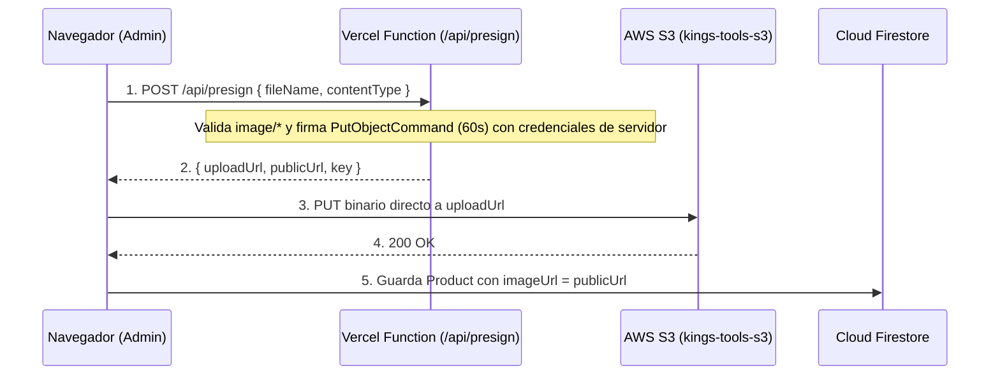
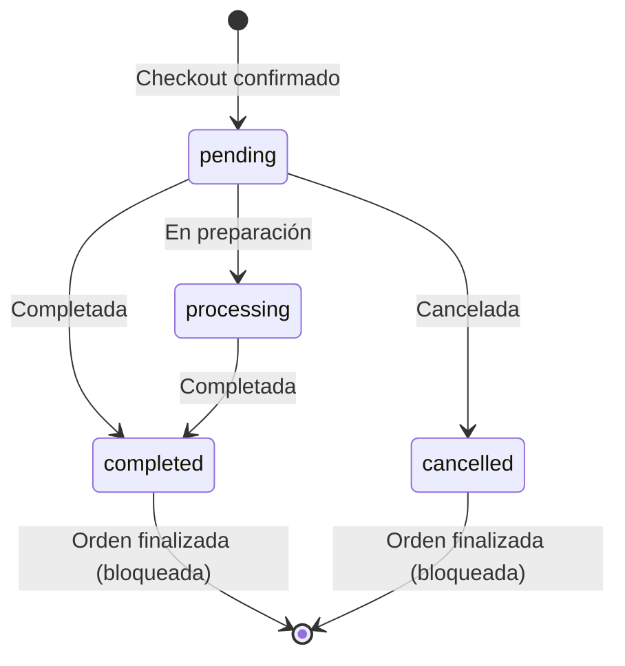

# King's Tools — E-Commerce de Ferretería Industrial y Herramientas

Aplicación **Single Page Application (SPA)** de comercio electrónico. Permite a los clientes explorar un catálogo de herramientas profesionales con búsqueda inteligente, filtrado por categoría y paginación por cursores, gestionar su carrito de compras persistente, simular el proceso de checkout y consultar el estado de sus órdenes; y a los administradores gestionar el inventario completo (**CRUD**) con subida de imágenes reales a **AWS S3** mediante **Presigned URLs** y administrar el ciclo de vida de los pedidos.

🔗 **Deploy en Producción (Vercel):** [https://kings-tools-ecommerce.vercel.app](https://kings-tools-ecommerce.vercel.app)

---

## Tabla de Contenidos

1. [Stack Tecnológico](#1-stack-tecnológico)
2. [Arquitectura y Decisiones Técnicas](#2-arquitectura-y-decisiones-técnicas)
3. [Funcionalidades Principales](#3-funcionalidades-principales)
4. [Flujo de Subida Segura a AWS S3 (Presigned URLs)](#4-flujo-de-subida-segura-a-aws-s3-presigned-urls)
5. [Máquina de Estados de Órdenes y Seguridad en Firestore](#5-máquina-de-estados-de-órdenes-y-seguridad-en-firestore)
6. [Variables de Entorno](#6-variables-de-entorno)
7. [Instalación, Seeder y Ejecución Local](#7-instalación-seeder-y-ejecución-local)
8. [Suite de Testing](#8-suite-de-testing)
9. [Bitácora de Uso Estratégico de IA](#9-bitácora-de-uso-estratégico-de-ia)

---

## 1. Stack Tecnológico

| Capa                              | Tecnología                               | Justificación                                                                                                                                                                                 |
| --------------------------------- | ---------------------------------------- | --------------------------------------------------------------------------------------------------------------------------------------------------------------------------------------------- |
| **Frontend Core**                 | **React 18 + TypeScript (Strict)**       | Tipado estricto (`strict: true`, sin `any`), interfaces de dominio explícitas y uniones discriminadas para las acciones del reducer.                                                          |
| **Build & Bundler**               | **Vite 6**                               | Compilación rápida con validación previa de tipos (`tsc -b && vite build`).                                                                                                                   |
| **Estilos**                       | **Tailwind CSS v4**                      | Integrado mediante `@tailwindcss/vite` y `@import "tailwindcss"`, diseño _mobile-first_, paleta industrial sobria (amarillo/carbón) y soporte de modo claro/oscuro (`ThemeContext`).          |
| **Ruteo**                         | **React Router v7**                      | Ruteo anidado con _Layout Routes_ (`MainLayout` y `AdminLayout`) y guardas separadas por responsabilidad (`ProtectedRoute` y `AdminRoute`).                                                   |
| **Estado Global**                 | **Context API + `useReducer`**           | Contextos separados por dominio (`AuthContext`, `CartContext`, `ProductsContext`, `ThemeContext`). El carrito utiliza un `cartReducer` 100% puro e inmutable sincronizado con `localStorage`. |
| **Autenticación y Base de Datos** | **Firebase Auth + Cloud Firestore**      | Login con Email/Password y Google OAuth, persistencia de roles (`customer` / `admin`) en `users/{uid}`, consultas indexadas y reglas de seguridad server-side (`firestore.rules`).            |
| **Almacenamiento de Imágenes**    | **AWS S3 + Vercel Serverless Functions** | Generación de **Presigned URLs** temporales (60 s) en `/api/presign` para subir imágenes directamente desde el navegador a S3 sin exponer credenciales de AWS.                                |
| **Testing**                       | **Vitest + React Testing Library**       | 6 suites (22 tests) cubriendo funciones puras/reducers, custom hooks con mocks, componentes UI y flujos integrales de compra.                                                                 |

---

## 2. Arquitectura y Decisiones Técnicas

El proyecto sigue una **arquitectura por capas con flujo unidireccional de datos**:

```text
Componentes / Páginas (UI)  ──►  Contexts / Custom Hooks  ──►  Capa de Servicios (src/services/)  ──►  Firebase / AWS S3
```

### Estructura de Directorios

```text
kings-tools/
├── api/
│   └── presign.ts                  # Vercel Serverless Function (firma criptográfica S3 PutObjectCommand)
├── docs/
│   ├── bitacora-ia.md              # Bitácora detallada de uso estratégico de IA
│   └── rubrica.md                  # Rúbrica de evaluación del proyecto
├── public/
│   └── images/logo.png             # Identidad visual de King's Tools
├── scripts/
│   └── seed.ts                     # Seeder idempotente de 60 productos de ferretería en 6 categorías
├── src/
│   ├── components/
│   │   ├── admin/                  # Formulario reutilizable ProductForm con integración S3
│   │   ├── layout/                 # Navbar y Footer responsivos
│   │   ├── orders/                 # OrderStatusBadge tipado
│   │   ├── products/               # ProductCard, ProductFilters y tests de componente
│   │   └── ui/                     # Kit UI base (Button, Input, Spinner, EmptyState, Alert)
│   ├── config/
│   │   └── firebase.ts             # Inicialización única de Firebase Auth y Firestore
│   ├── contexts/
│   │   ├── auth/                   # AuthProvider, useAuth y tests unitarios
│   │   ├── cart/                   # cartReducer puro, CartProvider, useCart y tests unitarios
│   │   ├── products/               # ProductsProvider con paginación por cursor y filtros
│   │   ├── theme/                  # ThemeProvider (modo claro / oscuro)
│   │   └── AppProviders.tsx        # Composición ordenada de proveedores globales
│   ├── hooks/
│   │   └── useDebounce.ts          # Custom hook genérico para búsqueda con retardo (400 ms)
│   ├── layouts/
│   │   ├── MainLayout.tsx          # Layout de tienda pública
│   │   └── AdminLayout.tsx         # Layout diferenciado para administración
│   ├── pages/
│   │   ├── admin/                  # AdminProductsPage (CRUD + S3) y AdminOrdersPage
│   │   ├── auth/                   # LoginPage y RegisterPage
│   │   ├── orders/                 # UserOrdersPage y OrderDetailPage
│   │   └── shop/                   # CatalogPage, ProductDetailPage, CartPage, CheckoutPage + tests
│   ├── routes/
│   │   ├── AppRouter.tsx           # Definición declarativa de rutas
│   │   ├── ProtectedRoute.tsx      # Guarda para usuarios autenticados
│   │   ├── AdminRoute.tsx          # Guarda exclusiva para role === 'admin'
│   │   └── routes.ts               # Constantes y constructores de rutas
│   ├── services/
│   │   ├── auth.service.ts         # Abstracción de Firebase Auth + colección users
│   │   ├── products.service.ts     # Consultas paginadas, búsqueda por prefijo y CRUD en Firestore
│   │   ├── orders.service.ts       # Creación, consulta y máquina de estados de órdenes
│   │   └── storage.service.ts      # Cliente de subida a AWS S3 mediante Presigned URL
│   ├── test/
│   │   ├── fixtures/               # Datos de prueba tipados
│   │   └── setup.ts                # Configuración global de Vitest + jest-dom/vitest
│   └── types/                      # Contratos TypeScript (Product, Cart, Order, User, Theme)
├── firestore.rules                 # Reglas de seguridad server-side de Firestore
├── firestore.indexes.json          # Definición de índices compuestos de Firestore
└── vercel.json                     # Rewrite SPA (/((?!api/).*) -> /index.html)
```

---

## 3. Funcionalidades Principales

- **Autenticación y Roles (`customer` / `admin`):**
  - Registro e inicio de sesión con Email/Password y Google (`signInWithPopup`).
  - Sincronización sin condiciones de carrera: `AuthProvider` mantiene `loading = true` hasta resolver el documento `users/{uid}` en Firestore, evitando redirecciones falsas en rutas protegidas.
- **Catálogo con Filtros, `useDebounce` y Paginación por Cursores (Extra Credit):**
  - Filtro por cualquiera de las 6 categorías industriales combinable con búsqueda por prefijo insensible a mayúsculas/minúsculas sobre el campo indexado `nameLower` (`>= prefix` y `<= prefix + '\uf8ff'`).
  - Hook `useDebounce` (400 ms) para evitar lecturas innecesarias en Firestore mientras el usuario escribe.
  - **Extra Credit — Paginación de Productos:** Paginación real en servidor usando cursores de Firestore (`limit(12)` + `startAfter(lastDoc)`).
- **Carrito de Compras (`useReducer` Puro + `localStorage`):**
  - Acciones tipadas con uniones discriminadas (`ADD_ITEM`, `REMOVE_ITEM`, `UPDATE_QUANTITY`, `CLEAR_CART`).
  - Control estricto de stock máximo tanto en el reducer como en las tarjetas y vista de detalle.
  - Estado derivado (`totalItems` y `totalPrice`) calculado con `useMemo`.
- **Checkout Simulado e Historial de Órdenes:**
  - Validación de datos de entrega, desnormalización de `OrderItem` (congelando precio e imagen al momento de la compra) y vaciado del carrito únicamente tras confirmar la escritura en Firestore.
- **Panel de Administración (`/admin/products` y `/admin/orders`):**
  - **CRUD completo de productos** con recálculo automático de `nameLower`, subida de imágenes a **AWS S3**, vista previa en vivo, confirmación inline en dos pasos antes de eliminar y refresco automático del catálogo público.
  - **Gestión global de órdenes** con filtro por estado y actualización controlada mediante máquina de estados con confirmación previa.

---

## 4. Flujo de Subida Segura a AWS S3 (Presigned URLs)

Las credenciales de AWS IAM (`AWS_ACCESS_KEY_ID` y `AWS_SECRET_ACCESS_KEY`) **nunca se exponen en el frontend** (no llevan prefijo `VITE_`). La subida se realiza en dos pasos:



---

## 5. Máquina de Estados de Órdenes y Seguridad en Firestore

Para garantizar la integridad contable del e-commerce, el estado de una orden no puede retroceder ni modificarse una vez finalizada. Esta regla se aplica en **3 capas** (`AdminOrdersPage.tsx`, `orders.service.ts` y `firestore.rules`):



- **Protección contra escalación de privilegios (`firestore.rules`):** Un usuario autenticado solo puede crear su documento en `users/{uid}` si `request.resource.data.role == "customer"`, y tiene bloqueado `update` y `delete`.
- **Privacidad de órdenes:** Cada cliente solo puede leer documentos de `orders` donde `resource.data.userId == request.auth.uid`.

---

## 6. Variables de Entorno

Copiá el archivo `.env.example` a `.env` en la raíz del proyecto y completá los valores:

```env
# Firebase Configuration (Frontend - Prefijo VITE_ obligatorio)
VITE_FIREBASE_API_KEY=
VITE_FIREBASE_AUTH_DOMAIN=
VITE_FIREBASE_PROJECT_ID=
VITE_FIREBASE_STORAGE_BUCKET=
VITE_FIREBASE_MESSAGING_SENDER_ID=
VITE_FIREBASE_APP_ID=

# AWS S3 Configuration (Solo para Vercel Serverless Functions - SIN prefijo VITE_)
AWS_ACCESS_KEY_ID=
AWS_SECRET_ACCESS_KEY=
AWS_REGION=us-east-2
S3_BUCKET=kings-tools-s3
```

---

## 7. Instalación, Seeder y Ejecución Local

1. **Instalar dependencias:**
   ```bash
   npm install
   ```
2. **Poblar la base de datos con los 60 productos iniciales (opcional si ya fue poblada):**
   ```bash
   npm run seed
   ```
3. **Levantar el servidor de desarrollo:**
   ```bash
   npm run dev
   ```
4. **Compilar para producción (chequeo estricto de TypeScript + bundle Vite):**
   ```bash
   npm run build
   ```

---

## 8. Suite de Testing

Para ejecutar todas las pruebas automatizadas con **Vitest** y **React Testing Library**:

```bash
npm test
```

| Archivo de Test                                              | Tipo                        | Qué valida                                                                                                                                                           |
| ------------------------------------------------------------ | --------------------------- | -------------------------------------------------------------------------------------------------------------------------------------------------------------------- |
| `src/contexts/cart/__tests__/cartReducer.test.ts`            | Unitario (Función pura)     | `ADD_ITEM`, `UPDATE_QUANTITY`, tope de `stock`, baja automática en cantidad `0`, `REMOVE_ITEM`, `CLEAR_CART` e inmutabilidad.                                        |
| `src/contexts/cart/__tests__/useCart.test.tsx`               | Unitario (Custom Hook)      | Cálculo derivado de `totalItems` y `totalPrice`, persistencia en `localStorage` y error fuera de `CartProvider`.                                                     |
| `src/services/__tests__/ordersTransitions.test.ts`           | Unitario (Regla de negocio) | Máquina de estados `ALLOWED_ORDER_TRANSITIONS`, `canTransitionOrderStatus` y bloqueo de transiciones inválidas en `updateOrderStatus`.                               |
| `src/contexts/auth/__tests__/useAuth.test.tsx`               | Unitario (Context + Mocks)  | Hidratación de perfil `customer`, inicio/cierre de sesión con rol `admin` (`isAdmin = true`) y captura de errores de autenticación.                                  |
| `src/components/products/__tests__/ProductCard.test.tsx`     | Componente UI               | Renderizado de datos, clic en `+ Agregar`, indicador de unidades en carrito, bloqueo por `Máx. stock` y producto `Sin stock`.                                        |
| `src/pages/shop/__tests__/CheckoutFlow.integration.test.tsx` | Integración E2E (Cliente)   | Flujo completo desde carrito con productos → validación de envío en `CheckoutPage` → llamada a `createOrder` → vaciado de carrito → redirección a `OrderDetailPage`. |

---

## 9. Bitácora de Uso Estratégico de IA

El desarrollo contó con asistencia de IA como par programador bajo supervisión técnica. El desarrollo extendido de cada entrada se encuentra en [`docs/bitacora-ia.md`](./docs/bitacora-ia.md).

| #   | Etapa / Tema                                                                                           | Prompt / Consulta realizada a la IA                                                                                                                                                                                                                                                                                                                                                                       | Qué aprendí                                                                                                                                                                                                                                                                                                                                                                                                                                                                                                                                       | Decisión técnica tomada                                                                                                                                                                                                                                                                                                                         |
| --- | ------------------------------------------------------------------------------------------------------ | --------------------------------------------------------------------------------------------------------------------------------------------------------------------------------------------------------------------------------------------------------------------------------------------------------------------------------------------------------------------------------------------------------- | ------------------------------------------------------------------------------------------------------------------------------------------------------------------------------------------------------------------------------------------------------------------------------------------------------------------------------------------------------------------------------------------------------------------------------------------------------------------------------------------------------------------------------------------------- | ----------------------------------------------------------------------------------------------------------------------------------------------------------------------------------------------------------------------------------------------------------------------------------------------------------------------------------------------- |
| 1   | **Paso 1:** Arquitectura y Contratos TypeScript                                                        | _"Necesito definir la arquitectura de carpetas y las interfaces TypeScript principales (Product, CartItem, Order, UserProfile) para un e-commerce de ferretería con React 18, Firestore y S3. ¿Conviene organizar por features o por capas? ¿Qué datos debo desnormalizar en CartItem y OrderItem para que el reducer del carrito sea puro y las órdenes históricas sean inmutables?"_                    | En bases NoSQL como Firestore conviene desnormalizar snapshots al momento de la compra. Además, incluir `stock` en `CartItem` permite que el `cartReducer` valide topes de cantidad sin consultar servicios externos, manteniéndose como una función pura. También aprendí que `CartAction` debe declararse como una Unión Discriminada (`type`) para tener inferencia exacta de `payload` sin usar `any`.                                                                                                                                        | Adopté una arquitectura por capas enriquecida (`components`, `pages`, `contexts`, `services`, `hooks`, `types`), agregué `nameLower` en `Product` para búsquedas por prefijo en Firestore, incluí `stock` en `CartItem` y congelé `price` e `imageUrl` dentro de `OrderItem`.                                                                   |
| 2   | **Paso 2:** Reglas de Firestore (`firestore.rules`) e IDs de documentos                                | _"Revisando las reglas de Firestore vistas en clase, en `users/{userId}` figura `allow write: if false`. Si bloqueo toda escritura ahí, ¿cómo crea el frontend el perfil con `role: 'customer'` al registrarse un usuario sin abrir la puerta a que alguien se auto-asigne `role: 'admin'`? Además, ¿conviene usar IDs armados con el nombre del producto en el seeder o el ID automático de Firestore?"_ | Aprendí que `allow write` engloba `create`, `update` y `delete`. Separando `allow create` con la condición `request.resource.data.role == "customer"` y dejando `allow update, delete: if false`, el registro funciona de forma segura sin riesgo de escalación de privilegios. Respecto a los IDs en `products`, aprendí que usar slugs acopla el ID al nombre original y genera inconsistencia con los IDs automáticos que creará el Panel Admin.                                                                                               | Configuré `firestore.rules` validando `role == "customer"` únicamente en `create` para `users/{userId}` y bloqueando ediciones posteriores desde el cliente. En `scripts/seed.ts` decidí utilizar el ID automático de Firestore (`doc(collection(db, 'products'))`) para mantener consistencia total con el CRUD del panel de administración.   |
| 3   | **Paso 3:** Sincronización entre Firebase Auth y Rol en Firestore                                      | _"Firebase Auth me devuelve el usuario en `onAuthStateChanged`, pero el rol (`customer` o `admin`) vive en la colección `users/{uid}` de Firestore. ¿Cómo manejo el estado de carga en `AuthProvider` para evitar que un administrador sea redirigido por error antes de que termine de leerse su rol en Firestore?"_                                                                                     | Identifiqué una condición de carrera habitual: si `loading` pasa a `false` apenas responde Firebase Auth pero antes de que resuelva `getDoc(doc(db, 'users', uid))`, existe un render intermedio donde el usuario no tiene rol cargado y `AdminRoute` lo expulsaría prematuramente. También aprendí que el primer login con Google puede no tener documento previo en `users/{uid}`, por lo que debe resolverse con una función `getOrCreateUserProfile`.                                                                                         | En `AuthProvider` inicialicé `loading: true` y lo mantuve en `true` dentro del callback asíncrono de `onAuthStateChanged` hasta que `getOrCreateUserProfile` devuelve el `UserProfile` completo con su `role` desde Firestore.                                                                                                                  |
| 4   | **Paso 4:** Ruteo anidado, Layouts por rol y Componentes UI tipados                                    | _"¿Conviene crear un único componente de ruta protegida con una prop `requiredRole` o separar `ProtectedRoute` y `AdminRoute`? Además, ¿cómo tipar componentes UI reutilizables (`Button`, `Input`) en TypeScript sin perder los atributos HTML nativos?"_                                                                                                                                                | Separar `ProtectedRoute` y `AdminRoute` como Layout Routes con `<Outlet />` permite anidar grupos enteros de rutas y aplicar un `AdminLayout` visualmente diferenciado sin repetir validaciones en cada página. En los componentes UI, extender `ButtonHTMLAttributes<HTMLButtonElement>` e `InputHTMLAttributes<HTMLInputElement>` permite combinar variantes propias con todos los atributos estándar de HTML y accesibilidad.                                                                                                                  | Implementé `ProtectedRoute` (redirige a `/login` guardando `location.state.from`) y `AdminRoute` (redirige a `/` si el rol es `customer`), envolviendo `MainLayout` y `AdminLayout` mediante `<Outlet />`, y construí el kit UI base (`Button`, `Input`, `Spinner`, `EmptyState`, `Alert`).                                                     |
| 5   | **Paso 5:** Catálogo en Firestore: `useDebounce`, paginación por cursor e índices compuestos           | _"¿Cómo implemento búsqueda por nombre sin distinguir mayúsculas/minúsculas combinada con filtro por categoría y paginación en Firestore sin descargar los 60 productos de golpe ni disparar una query por cada tecla?"_                                                                                                                                                                                  | Aprendí que Firestore no tiene `ILIKE` ni `OFFSET` tradicional: la búsqueda por prefijo se resuelve con `where('nameLower', '>=', prefix)` y `where('nameLower', '<=', prefix + '\uf8ff')`, la paginación eficiente usa cursores (`limit(12)` + `startAfter(lastDoc)`), y combinar `where('categoryId', '==', ...)` con `orderBy('nameLower')` exige un índice compuesto en Firestore. Además, `useDebounce(searchText, 400)` evita lecturas innecesarias mientras el usuario escribe.                                                            | Creé el hook genérico `useDebounce`, implementé `listProducts` con `limit` y `startAfter` en `products.service.ts`, gestioné el cursor con `useRef` en `ProductsProvider` para evitar ciclos de renderizado y configuré el índice compuesto `categoryId ASC + nameLower ASC` en Firestore.                                                      |
| 6   | **Paso 6:** Deploy temprano en Vercel, Rewrites SPA y Dominios Autorizados                             | _"Al desplegar una SPA con React Router en Vercel que más adelante tendrá funciones serverless en `/api`, ¿por qué da error 404 al recargar rutas como `/login` y cómo configuro `vercel.json` sin interceptar las rutas `/api/_`?"\*                                                                                                                                                                     | En una SPA las rutas existen en el cliente; si el usuario recarga `/login` con `F5`, el servidor de Vercel busca un archivo físico `/login` y devuelve 404 salvo que se configure un rewrite hacia `/index.html`. Además, usar la expresión `/((?!api/).*)` evita que el rewrite intercepte las futuras Vercel Serverless Functions dentro de `/api/`. También aprendí que Firebase Auth bloquea el login con Google en producción si el dominio `.vercel.app` no se agrega en _Authorized domains_.                                              | Configuré `vercel.json` con el rewrite `/((?!api/).*) -> /index.html`, verifiqué el build de TypeScript (`npm run build`), cargué las variables `VITE_FIREBASE_*` en Vercel y autoricé el dominio de producción en Firebase Authentication.                                                                                                     |
| 7   | **Paso 7:** Carrito con `useReducer` puro, persistencia en `localStorage` y Tests Unitarios con Vitest | _"¿Por qué conviene usar `useReducer` en lugar de `useState` para el carrito de compras, dónde debe vivir la sincronización con `localStorage` para no romper la pureza del reducer y cómo testear el reducer y el hook `useCart` de forma aislada?"_                                                                                                                                                     | `useReducer` centraliza múltiples transiciones relacionadas (`ADD_ITEM`, `REMOVE_ITEM`, `UPDATE_QUANTITY`, `CLEAR_CART`) y reglas de negocio (como el tope de stock) fuera de los componentes. Aprendí que si llamara a `localStorage.setItem` adentro del reducer, dejaría de ser una función pura; por eso la lectura inicial se pasa como 3er argumento (_lazy initializer_) de `useReducer` y la escritura se delega a un `useEffect` en `CartProvider`. Así `cartReducer` se testea sin montar React y `useCart` se testea con `renderHook`. | Implementé `cartReducer` como función 100% pura e inmutable, sincronicé `localStorage` en `CartProvider`, calculé `totalItems` y `totalPrice` como estado derivado con `useMemo` y escribí los tests unitarios en `cartReducer.test.ts` y `useCart.test.tsx`.                                                                                   |
| 8   | **Paso 8:** Flujo de Checkout, estados de Orden y aislamiento por `userId`                             | _"En el flujo de checkout, ¿en qué orden debo ejecutar la creación de la orden en Firestore, la limpieza del carrito y la redirección para no perder los ítems si falla la red? Además, ¿cómo garantizo que un cliente solo pueda consultar sus propias órdenes?"_                                                                                                                                        | Si vaciamos el carrito antes de que resuelva la promesa `createOrder`, un corte de red haría que el cliente pierda todo su pedido sin que la orden se haya guardado. El carrito solo debe vaciarse tras recibir el `orderId` confirmado por Firestore. Para la privacidad del historial, combinamos `where('userId', '==', user.uid)` en el frontend con la regla `resource.data.userId == request.auth.uid` en `firestore.rules`.                                                                                                                | Implementé `orders.service.ts` (`createOrder`, `getUserOrders`, `getOrderById`, `getAllOrders`, `updateOrderStatus`), validé el formulario de envío en `CheckoutPage` vaciando el carrito únicamente tras el `await createOrder`, y construí `UserOrdersPage` y `OrderDetailPage` con badges de estado tipados.                                 |
| 9   | **Paso 9:** AWS S3 con Presigned URLs y Vercel Serverless Functions                                    | _"¿Por qué las credenciales de Firebase pueden ir con prefijo `VITE_` en el frontend pero las de AWS S3 jamás deben exponerse en el navegador? ¿Por qué conviene usar Presigned URLs en lugar de enviar el archivo binario a través de la Serverless Function?"_                                                                                                                                          | Las claves de Firebase solo identifican el proyecto y están resguardadas por Auth + Firestore Rules; en cambio, `AWS_SECRET_ACCESS_KEY` otorga control directo sobre el bucket. Además, subir la imagen pasando por la Vercel Function duplicaría el tráfico y chocaría con el límite de tamaño de payload (4.5 MB en Vercel). Con una Presigned URL temporal (60 s), la Function solo firma el permiso criptográfico y el navegador hace el `PUT` directo a S3.                                                                                  | Creé la Vercel Function `api/presign.ts` leyendo variables de entorno sin prefijo `VITE_` (`AWS_ACCESS_KEY_ID`, `AWS_SECRET_ACCESS_KEY`, `AWS_REGION`, `S3_BUCKET`) y el servicio `src/services/storage.service.ts` que solicita la URL firmada y ejecuta el `PUT` directo a S3 con límite de 5 MB.                                             |
| 10  | **Paso 10:** Panel de Administración (CRUD de Productos con S3 y Máquina de Estados de Órdenes)        | _"Al crear o editar un producto desde el Panel Admin, ¿cómo garantizo que siga apareciendo en las búsquedas por prefijo del catálogo público y cómo evito que el administrador retroceda órdenes completadas o canceladas a estados anteriores?"_                                                                                                                                                         | Si no se recalcula `nameLower = name.trim().toLowerCase()` en la capa de servicio, el producto queda invisible en las búsquedas por prefijo. En las órdenes, el estado debe modelarse como una máquina de estados unidireccional (`pending -> processing \| completed \| cancelled`, `processing -> completed`, y `completed`/`cancelled` como estados terminales inmutables) tanto en el servicio y la UI como en `firestore.rules`.                                                                                                             | Implementé `createProduct`, `updateProduct` y `deleteProduct` recalculando `nameLower`, construí `ProductForm` con subida directa a S3 y desarrollé `AdminProductsPage` y `AdminOrdersPage` restringiendo las transiciones de estado mediante `ALLOWED_ORDER_TRANSITIONS`, confirmación en dos pasos y reglas server-side en `firestore.rules`. |
| 11  | **Paso 11:** Estrategia de Testing Unitario y de Integración con Vitest y RTL                          | _"¿Cómo diseño una suite de tests que cubra funciones puras, custom hooks con servicios externos (`useAuth`), componentes visuales (`ProductCard`) y un flujo integral de compra (`CheckoutPage` -> `OrderDetailPage`) sin conectarse a Firebase real?"_                                                                                                                                                  | Aprendí que gracias a nuestra arquitectura en capas (`UI -> Context/Hooks -> Services -> Firebase`), en los tests de hooks y de integración basta con hacer `vi.mock()` sobre nuestra capa `src/services/*` en vez de mockear todo el SDK interno de Firebase. Además, en `@testing-library/jest-dom` v7 se debe importar `@testing-library/jest-dom/vitest` para extender `Assertion<T>` en TypeScript.                                                                                                                                          | Completé 6 suites de tests (22 tests en total): `cartReducer.test.ts`, `useCart.test.tsx`, `ordersTransitions.test.ts`, `useAuth.test.tsx`, `ProductCard.test.tsx` y `CheckoutFlow.integration.test.tsx` utilizando `vi.hoisted`, `userEvent` y `MemoryRouter`.                                                                                 |
| 12  | **Paso 12:** Auditoría de Seguridad, Revisión de Código y Documentación Final                          | _"Necesito realizar una auditoría general de seguridad y calidad antes de la entrega final: verificar que ningún secreto quede expuesto en el bundle cliente, que las transiciones de órdenes tengan confirmación previa e integridad server-side, y estructurar el README técnico con la bitácora de IA."_                                                                                               | En la revisión integral detecté que como las transiciones de estado de órdenes son irreversibles, convenía agregar una confirmación inline en dos pasos antes de ejecutar `updateOrderStatus`, y preservar el contexto `state={{ fromAdmin: true }}` al navegar al comprobante desde `/admin/orders`. También verifiqué el comportamiento del aviso COOP (`Cross-Origin-Opener-Policy`) del popup de Google OAuth.                                                                                                                                | Apliqué confirmación en dos pasos para cambios de estado en `AdminOrdersPage.tsx`, retorno contextual en `OrderDetailPage.tsx`, publiqué las reglas definitivas en `firestore.rules` y documenté la arquitectura completa y la bitácora en `README.md`.                                                                                         |
